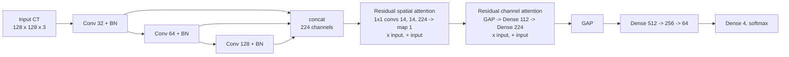

# Dual-Attention CNN for Kidney Ailment Classification from CT Images

[](https://github.com/RashiChauhan67/kidney-ct-attention-cnn/actions/workflows/ci.yml)
[](LICENSE)


> **Paper.** R. Chauhan, M. Karnati, P. Singh. *Attention Based Deep Neural Network for Classification of Kidney Ailments Using CT Images.* 2024 15th International Conference on Computing Communication and Networking Technologies (**ICCCNT**), IEEE, 2024. DOI: [10.1109/ICCCNT61001.2024.10723909](https://doi.org/10.1109/ICCCNT61001.2024.10723909)

A small CNN that classifies kidney CT slices into **cyst, normal, stone and tumor**. It combines dense-style feature reuse (three concatenated conv blocks) with a **spatial attention** module and a **channel attention** module.

The code was cleaned up from the original Kaggle notebook (kept unmodified in [`notebooks/`](notebooks/)). Please read [Relationship between this code and the paper](#relationship-between-this-code-and-the-paper): the saved notebook differs from the paper in its classifier head, its parameter count and its final accuracy.

## Highlights

- Four classes on 12,446 CT images; 80% / 20% train / test split.
- Recorded test accuracy in the notebook: **98.96%** on 2,490 held-out images (the paper reports 99.48%).
- 0.415 M parameters in the saved notebook (the paper states 0.22 M; see below).
- Modular Keras 3 port with unit tests, a command-line trainer, and two training protocols (`notebook` and a leakage-free `holdout`).

## Architecture

The author's figure from the paper:


What the code in `src/kidney_dacnn/model.py` builds (this matches the saved notebook, verified by parameter count):



## Relationship between this code and the paper

| Item | Paper | Saved notebook (and this code by default) |
|---|---|---|
| Classifier head | Dense 256, 64, 4 (figure) | Dense **512**, 256, 64, 4 |
| Parameters | 0.22 M | **414,837** (0.415 M). Dropping the Dense 512 layer gives 225,909, which matches the paper's figure. |
| Test accuracy | 99.48% | **98.96%** |
| Order of attention modules | Channel, then spatial (figure) | Spatial, then channel |
| Module widths | Channel: Dense 64, 64. Spatial: 3x3 convs of 8, 8, 64, then 1x1 | Channel: Dense C/2 then C. Spatial: 1x1 convs of C/16, C/16, C, then 1 (C = 224) |
| Split, batch size, epochs, optimizer | 80:20, 16, 50, Adam | the same |

`build_model(dense_units=PAPER_FIGURE_DENSE_UNITS)` builds the head drawn in the paper's figure (about 0.22 M parameters). That variant was **not trained** in the saved notebook, so no result is claimed for it. If you have the notebook that produced the 99.48% figure, it is not this one.

The parameter counts were checked by rebuilding the model and comparing with the notebook's `model.summary()`: 414,389 trainable plus 448 non-trainable (the "1,243,617 total" in the notebook includes Adam's optimizer state).

## Dataset

[CT KIDNEY DATASET: Normal-Cyst-Tumor and Stone](data/README.md) (12,446 CT images: 3,709 cyst, 5,077 normal, 1,377 stone, 2,283 tumor). Not included. Images are resized to 128 x 128, scaled to [0, 1] and read with OpenCV.

## Installation

```bash
git clone https://github.com/RashiChauhan67/kidney-ct-attention-cnn.git
cd kidney-ct-attention-cnn
python -m venv .venv && source .venv/bin/activate
pip install -e .
```

## Usage

```bash
# Original protocol (the test split also drives early stopping; see below)
python scripts/train.py --data-dir /path/to/CT-KIDNEY-DATASET-Normal-Cyst-Tumor-Stone \
    --dataset ct-kidney --output-dir runs/notebook

# Leakage-free protocol: validation is taken from the training data, the test set is used once
python scripts/train.py --data-dir /path/to/CT-KIDNEY-DATASET-Normal-Cyst-Tumor-Stone \
    --dataset ct-kidney --protocol holdout --output-dir runs/holdout

# Evaluate a saved model on the regenerated test split
python scripts/evaluate.py --data-dir /path/to/CT-KIDNEY-DATASET-Normal-Cyst-Tumor-Stone \
    --dataset ct-kidney --model runs/holdout/best_model.keras
```

Defaults follow the notebook: Adam (Keras default learning rate), batch size 16, up to 50 epochs, early stopping on validation accuracy (patience 10, best weights restored; the notebook loaded its best checkpoint, which is equivalent). Each run writes `best_model.keras`, `history.json` and `metrics.json`.

```python
from kidney_dacnn.model import build_model, compile_model

model = compile_model(build_model())  # 414,837 parameters
```

## Recorded results (from the original notebook)

These are the numbers stored in the notebook's outputs. **They were not re-run for this repository.**

Test accuracy **0.9896**, test loss 0.0289, on 2,490 images (20% of 12,446). Model checkpoint: epoch 15 of 25 epochs run.

| Class | Precision | Recall | F1 | Support | AUC |
|---|---|---|---|---|---|
| Cyst | 0.98 | 0.99 | 0.98 | 740 | 0.9996 |
| Normal | 1.00 | 1.00 | 1.00 | 1036 | 1.0000 |
| Stone | 1.00 | 0.94 | 0.97 | 272 | 0.9996 |
| Tumor | 0.98 | 1.00 | 0.99 | 442 | 1.0000 |
| macro avg | 0.99 | 0.98 | 0.99 | 2490 | |

The weakest class is Stone (recall 0.94): 14 stones were predicted as cysts and 3 as normal.

| Confusion matrix (counts) | Confusion matrix (normalized) |
|---|---|
|  |  |

| ROC curves | Per-class precision / recall / F1 |
|---|---|
|  |  |

Training curves from the notebook run. **Validation accuracy is very unstable**, swinging between about 0.2 and 0.99 from one epoch to the next (0.61 in the last epoch), while training accuracy rises smoothly:

| Accuracy | Loss |
|---|---|
|  |  |

t-SNE of the features before and after training:

| Original features | Trained features |
|---|---|
|  |  |

## Limitations and reproducibility notes

- **The recorded test accuracy is optimistic.** The notebook passes the test split as `validation_data`, and early stopping and checkpoint selection monitor it. The reported accuracy (0.9896) equals the best validation accuracy exactly, at epoch 15. Given how unstable the validation curve is, a different epoch would have scored very differently. Use `--protocol holdout` for numbers that are not selected on the test set.
- The split is random (not stratified) and at the image level. If several slices come from the same patient they can appear on both sides of the split, which can inflate accuracy. The dataset does not provide patient identifiers in the notebook.
- No framework-level random seeds are set in the notebook, so a re-run will not reproduce the recorded numbers bit for bit. This port reads files in sorted order, so the exact test images can differ slightly from the original run.
- The notebook's FLOPs figure (about 0.2 GFLOPs) comes from a hand-written estimator that applies the *model input shape* to every convolution, so it should not be relied on. Model size printed by the notebook (1.58 MB) counts trainable weights only.
- AUC values are read from the ROC plot legend.
- Not a medical device. This is research code and has not been validated for clinical use.

## Repository layout

```
.
├── src/kidney_dacnn/    # model, data loading, training and evaluation
├── scripts/             # train.py, evaluate.py
├── tests/               # unit tests (synthetic data; no dataset needed)
├── notebooks/           # original notebook (unmodified)
├── docs/figures/        # architecture figure from the paper
├── results/             # recorded notebook results and figures
└── data/README.md       # dataset instructions
```

## Development

```bash
pip install -e ".[dev]"
ruff check .
pytest
```

The tests check, among other things, that the default model has exactly the parameter count printed by the notebook (414,837) and that the paper-figure head has about 0.22 M.

## Citation

If you use this code, please cite the paper (a `CITATION.cff` is provided):

```bibtex
@inproceedings{chauhan2024kidney,
  author    = {Chauhan, Rashi and Karnati, Mohan and Singh, Pradeep},
  title     = {Attention Based Deep Neural Network for Classification of Kidney Ailments Using {CT} Images},
  booktitle = {2024 15th International Conference on Computing Communication and Networking Technologies (ICCCNT)},
  publisher = {IEEE},
  year      = {2024},
  doi       = {10.1109/ICCCNT61001.2024.10723909}
}
```

## License

MIT. See [LICENSE](LICENSE). The dataset has its own license; check it before reuse.

**Figures.** The architecture figure in `docs/figures/` is reproduced from the paper by its authors. Reuse of that figure is subject to the publisher's terms (IEEE); the MIT license covers the code, and the result plots generated from the notebook.
