# Kidney CT Attention CNN

**A lightweight dual-attention CNN that classifies kidney CT slices as cyst, normal, stone or tumor.**

[](https://github.com/RashiChauhan67/kidney-ct-attention-cnn/actions/workflows/ci.yml)
[](LICENSE)


> **Paper.** R. Chauhan, M. Karnati, P. Singh. *Attention Based Deep Neural Network for Classification of Kidney Ailments Using CT Images.* 2024 15th International Conference on Computing Communication and Networking Technologies (**ICCCNT**), IEEE, 2024. DOI: [10.1109/ICCCNT61001.2024.10723909](https://doi.org/10.1109/ICCCNT61001.2024.10723909)

[Overview](#overview) · [Architecture](#architecture) · [Pipeline](#pipeline) · [Quick start](#quick-start) · [Dataset](#dataset) · [Results](#results) · [Notes](#notes) · [Citation](#citation)

## Overview

Three stacked conv blocks are concatenated (dense-style feature reuse), refined by a **residual spatial attention** module and a **residual channel attention** module, pooled, and classified by a small MLP.

This repository has a cleaned, tested Keras 3 implementation, the original experiment notebook, and the recorded results.

| | |
|---|---|
| Classes | cyst, normal, stone, tumor |
| Images | 12,446 CT slices (80% train / 20% test) |

| | Paper (ICCCNT 2024) | This repository (recorded notebook run) |
|---|---|---|
| Test accuracy | **99.48%** | 98.96% (2,490 test images) |
| Parameters | about 0.22 M | 414,837 (0.415 M) |
| Input | not listed here | 128 x 128 x 3 |

The paper column is as reported in the paper. The repository column is the value recorded in the original notebook. The two runs differ in accuracy and model size, and this code has not been shown to reproduce the paper's 99.48%. For the published results, use the paper.

## Architecture

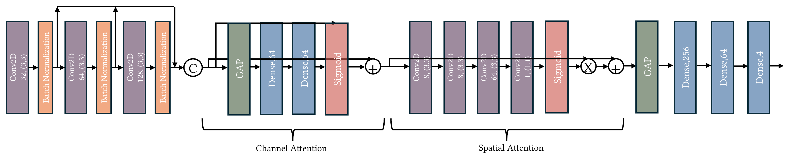

## Pipeline

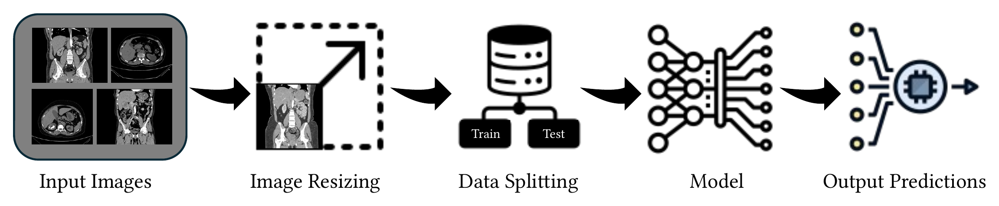

## Quick start

```bash
git clone https://github.com/RashiChauhan67/kidney-ct-attention-cnn.git
cd kidney-ct-attention-cnn
python -m venv .venv && source .venv/bin/activate
pip install -e .
```

Train and evaluate:

```bash
# Original protocol (single train/test split)
python scripts/train.py --data-dir /path/to/CT-KIDNEY-DATASET-Normal-Cyst-Tumor-Stone \
    --dataset ct-kidney --output-dir runs/notebook

# Holdout protocol: validation is taken from the training data; the test set is used once
python scripts/train.py --data-dir /path/to/CT-KIDNEY-DATASET-Normal-Cyst-Tumor-Stone \
    --dataset ct-kidney --protocol holdout --output-dir runs/holdout

# Evaluate a saved model on the regenerated test split
python scripts/evaluate.py --data-dir /path/to/CT-KIDNEY-DATASET-Normal-Cyst-Tumor-Stone \
    --dataset ct-kidney --model runs/holdout/best_model.keras
```

Defaults: Adam (Keras default learning rate), batch size 16, up to 50 epochs, early stopping on validation accuracy (patience 10, best weights restored). Each run writes `best_model.keras`, `history.json` and `metrics.json`.

Use the model directly:

```python
from kidney_dacnn.model import build_model, compile_model

model = compile_model(build_model())  # 414,837 parameters
```

## Dataset

CT KIDNEY DATASET: Normal-Cyst-Tumor and Stone: 12,446 images (3,709 cyst, 5,077 normal, 1,377 stone, 2,283 tumor). Data is not included; see [`data/README.md`](data/README.md) for the folder layout, source and citation. Images are resized to 128 x 128, scaled to [0, 1] and read with OpenCV.

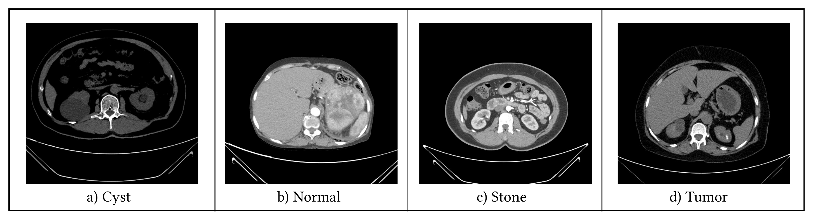

## Results

### Reported in the paper

Overall accuracy **99.48%** on an 80:20 train/test split of the 12,446 images, with about 0.22 M parameters (Chauhan, Karnati and Singh, ICCCNT 2024, Table I).

| Class | Precision | Recall | F1 |
|---|---|---|---|
| Cyst | 0.99 | 1.00 | 1.00 |
| Normal | 0.99 | 1.00 | 0.99 |
| Stone | 1.00 | 0.94 | 0.97 |
| Tumor | 1.00 | 1.00 | 1.00 |

Stone is the weakest class in the paper as well (recall 0.94).

### Recorded in this repository (original notebook)

Results from the original experiment notebook. Full tables are in [`results/recorded_results.md`](results/recorded_results.md). These differ from the paper's figures above.

Test accuracy **0.9896**, test loss 0.0289, on 2,490 images.

| Class | Precision | Recall | F1 | Support | AUC |
|---|---|---|---|---|---|
| Cyst | 0.98 | 0.99 | 0.98 | 740 | 0.9996 |
| Normal | 1.00 | 1.00 | 1.00 | 1036 | 1.0000 |
| Stone | 1.00 | 0.94 | 0.97 | 272 | 0.9996 |
| Tumor | 0.98 | 1.00 | 0.99 | 442 | 1.0000 |
| macro avg | 0.99 | 0.98 | 0.99 | 2490 | |

The weakest class is Stone: 14 stones were predicted as cysts and 3 as normal.

| Confusion matrix (counts) | Confusion matrix (normalized) |
|---|---|
| 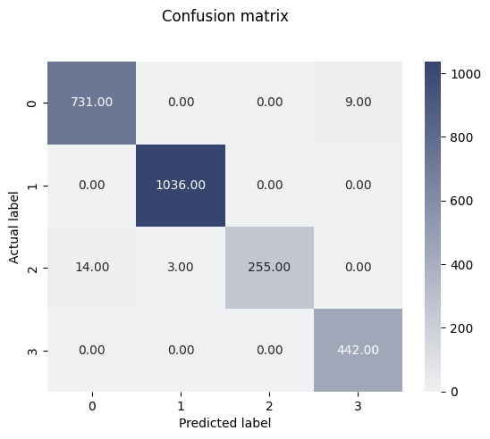 | 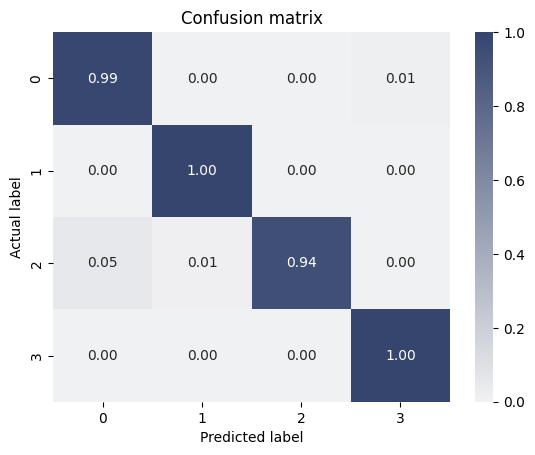 |

| ROC curves | Per-class precision / recall / F1 |
|---|---|
| 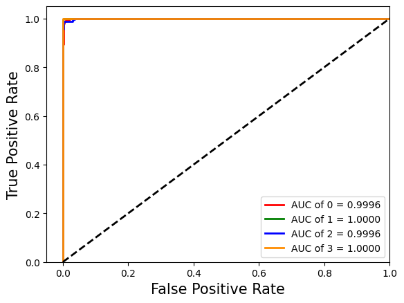 | 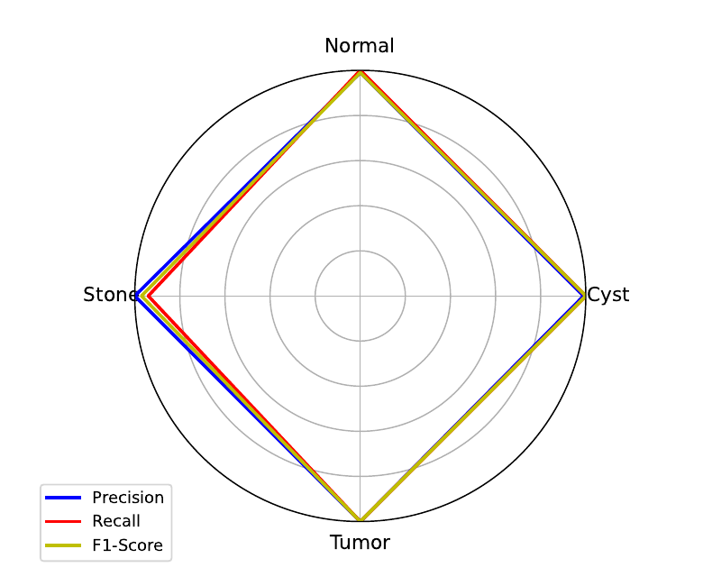 |

Training curves:

| Accuracy | Loss |
|---|---|
| 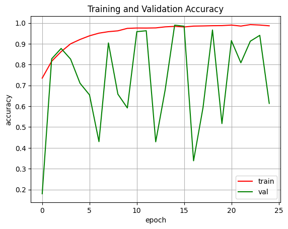 | 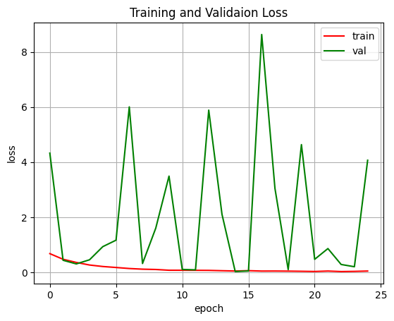 |

t-SNE of the features before and after training:

| Original features | Trained features |
|---|---|
| 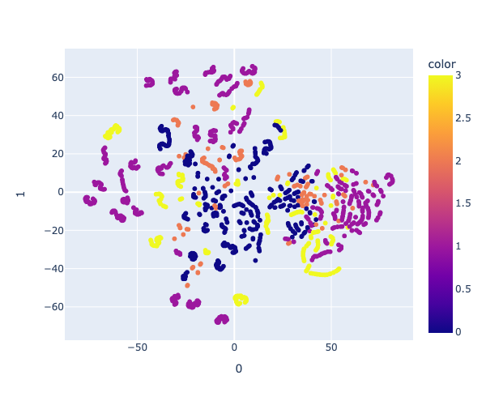 | 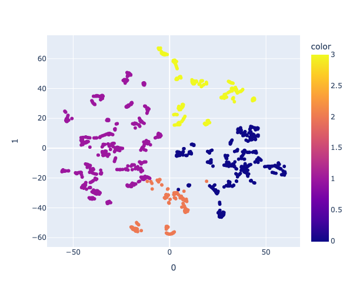 |

## Notes

- The default model has 414,837 parameters (414,389 trainable + 448 non-trainable), matching the notebook's `model.summary()`. Spatial attention is applied before channel attention.
- The paper reports about 0.22 M parameters and 99.48% accuracy; the recorded notebook run in this repository has 0.415 M parameters and 98.96% accuracy (see [Overview](#overview)).
- `build_model(dense_units=COMPACT_DENSE_UNITS)` builds a smaller Dense 256 -> 64 head (225,909 parameters).
- `--protocol holdout` trains with a validation set taken from the training data and uses the test set once.
- Research code only; not validated for clinical use.

## Repository structure

```
.
├── src/kidney_dacnn/    # model, data loading, training and evaluation
├── scripts/             # train.py, evaluate.py
├── tests/               # unit tests (synthetic data; no dataset needed)
├── notebooks/           # original experiment notebook
├── docs/figures/        # architecture, pipeline and dataset figures
├── results/             # recorded notebook results and figures
└── data/README.md       # dataset instructions
```

Development: `pip install -e ".[dev]"`, then `ruff check .` and `pytest`.

## Citation

If you use this code, please cite the paper (a `CITATION.cff` is provided):

```bibtex
@inproceedings{chauhan2024kidney,
  author    = {Chauhan, Rashi and Karnati, Mohan and Singh, Pradeep},
  title     = {Attention Based Deep Neural Network for Classification of Kidney Ailments Using {CT} Images},
  booktitle = {2024 15th International Conference on Computing Communication and Networking Technologies (ICCCNT)},
  publisher = {IEEE},
  year      = {2024},
  doi       = {10.1109/ICCCNT61001.2024.10723909}
}
```

## License

MIT. See [LICENSE](LICENSE). The dataset has its own license; check it before reuse.

**Figures.** The architecture and pipeline figures in `docs/figures/` are reproduced from the paper by its authors. Reuse of those figures is subject to the publisher's terms (IEEE). The sample CT slices come from the dataset cited in `data/README.md`; check its license. The MIT license covers the code and the result plots generated from the notebook.
